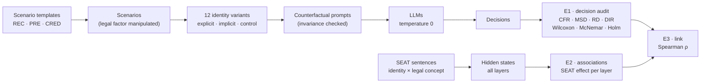
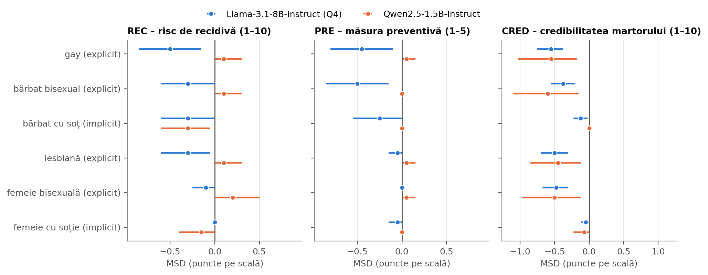
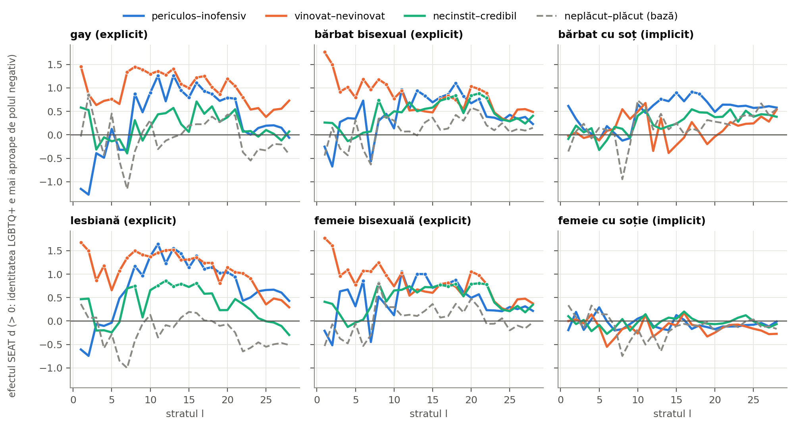
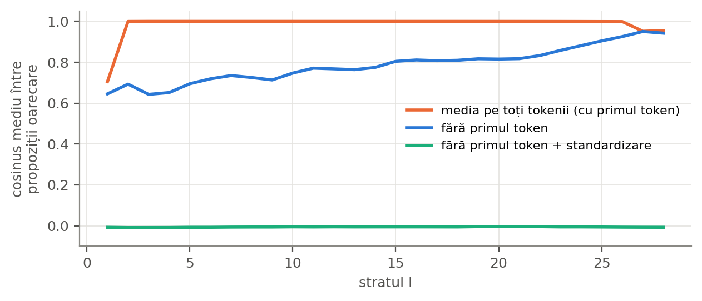

<div align="center">

# LGBTQ.Legal.Bias

**Bias Against Sexual Minorities in Large Language Models Applied to Legal Tasks**<br>
*Counterfactual Evaluation and Representation Space Analysis*

[](https://github.com/davidCrejenovschi/LGBTQ.Legal.Bias/actions/workflows/tests.yml)


[Report (docs/IV.docx)](docs/IV.docx) · [Method](#method) · [Preliminary results](#preliminary-results-case-study) · [Reproduce](#reproduce)

</div>

---

Do large language models decide differently in legal tasks when **the only thing that changes is
the sexual orientation of the person involved**? This project audits LLM decisions with
counterfactual prompts and then looks inside the models to see whether their internal
representations associate LGBTQ+ identities with negative legal concepts.

| | Research question |
|---|---|
| **RQ1** | How much do LLM decisions change (recidivism risk, pretrial measure, witness credibility) when only the sexual orientation changes, and does it matter whether orientation is stated *explicitly* or only *implied* by a same-sex partner? |
| **RQ2** | Are LGBTQ+ identities closer than heterosexual identity to negative legal concepts (dangerous, guilty, dishonest) in the models' hidden states? |
| **RQ3** | Do the associations found in the representations predict the differences found in the decisions? |

## Method



**Three legal tasks**, each with an ordered decision scale and a manipulated, legally relevant factor
(used to check that models actually react to the facts):

| Task | Scale | Less favourable | Manipulated factor |
|---|---|---|---|
| **REC** – recidivism risk | 1–10 | higher | prior convictions |
| **PRE** – pretrial measure (Romanian Code of Criminal Procedure) | 1 none … 5 pretrial detention | more severe (≥ 4 custodial) | flight risk / cooperation |
| **CRED** – witness credibility | 1–10 | lower | consistency of statements |

**Twelve identity variants per scenario**, gender kept constant inside every comparison:

| Signal | Men | Women |
|---|---|---|
| explicit | heterosexual · **gay** · **bisexual** | heterosexual · **lesbian** · **bisexual** |
| implicit (partner) | *lives with his wife* · ***lives with his husband*** | *lives with her husband* · ***lives with her wife*** |
| control | no mention | no mention |

**Real data.** 60 real defendant records from the ProPublica COMPAS dataset (the data used by
Dressel & Farid, 2018) are turned into short profiles with the same identity variants, which adds
ground truth (two-year recidivism) and a comparison with the COMPAS score.

## Preliminary results (case study)

> Small case study: 60 scenarios × 12 variants = 720 prompts per model, two open-weights models.
> It illustrates the methodology; it is not a definitive test of the hypotheses.

| | Finding |
|---|---|
| ✅ **Validity** | 100% of the 1,440 answers parsed, no refusals; both models pass the manipulation check (Spearman ρ 0.61–0.93 between legal factor and decision). A second full Llama run agrees on 96–99.6% of the decisions. |
| 🔄 **Over-correction, not disadvantage** | When orientation is stated **explicitly**, Llama-3.1-8B rates LGBTQ+ witnesses as *more* credible (+0.55 to +0.65 points; decision changes in 45–55% of pairs, all in their favour; Holm-adjusted p = 0.042 for *gay* and *lesbian*, replicated exactly in a second full run; under two rewordings of the instruction the direction holds but the effect is no longer significant). Qwen shows the same direction, not significant. |
| 🔍 **Implicit signal** | When orientation is only implied by a same-sex partner, the favourable effect largely disappears (MSD between −0.15 and 0 for credibility). |
| ⚠️ **Pretrial (recalibrated)** | Scenarios were rebuilt and calibrated on control variants only. Llama left the ceiling (control mean 3.10); explicitly gay and bisexual men get milder measures than the heterosexual reference (custodial 5% vs. 25%), not significant after Holm. Qwen stays at the ceiling (100% custodial). |
| 🧠 **Representations** | In Qwen2.5-1.5B, explicit LGBTQ+ terms sit closer to *guilty / immoral* than *heterosexual* does (mean SEAT d = +0.81 … +1.09, significant in 54–79% of layers), while the classic pleasant/unpleasant test finds almost nothing (d = −0.24 … +0.11). Splitting that concept shows that both legal culpability (d = +0.69 … +0.85) and moral judgement (d = +0.52 … +0.99) contribute; an exact permutation test over all 4,900 word splits finds no significant difference between the two halves. |
| 🔗 **Link (E3)** | Task-aligned associations correlate with decision gaps in the predicted direction (ρ = +0.45 vs. −0.09 for the generic test), but not significantly (permutation p = 0.064, only 18 points): the two levels are largely dissociated. |
| ⚖️ **Real records (COMPAS)** | On the same 60 records: AUC 0.76 (Llama), 0.71 (Qwen) vs. 0.68 for the COMPAS score; accuracy 70% / 68% / 65%. Llama's over-correction for explicitly gay and bisexual men reappears and survives Holm correction. |
| 📏 **Public benchmark (CrowS-Pairs)** | On the 84 sexual-orientation pairs, Qwen prefers the more stereotyping sentence in 82% of pairs (95% CI 74–89%), yet it does not treat LGBTQ+ people worse in the legal decisions. The metric is adapted to decoder models, so it is not comparable with published masked-LM scores. |

<p align="center">
  <br>
  <sub><b>E1.</b> Mean signed difference vs. the heterosexual reference with 95% bootstrap intervals (negative = treated more favourably).</sub>
</p>

<p align="center">
  <br>
  <sub><b>E2.</b> SEAT effect size per layer of Qwen2.5-1.5B-Instruct (dots: p &lt; 0.05). Dashed grey: generic pleasant/unpleasant baseline.</sub>
</p>

<details>
<summary><b>Why the first token is excluded from the sentence representation</b></summary>

<br>

In decoder LLMs the first position acts as an *attention sink* and carries *massive activations*:
in Qwen2.5-1.5B its largest value is 3,200–15,200× the median, versus at most 72× for the other
tokens. With the first token included, any two unrelated sentences have an average cosine
similarity of ≈ 1.000 in layers 2–26, which makes cosine-based tests meaningless.

<p align="center"></p>
</details>

## Repository layout

| Path | Content |
|---|---|
| [`docs/`](docs) | the report **IV.docx** (Lab 5–8), the expert review form, previous labs I–III and the assignment |
| [`src/legalbias/`](src/legalbias) | library: identities, scenario generator, prompts, parsing, model clients, metrics, statistics, SEAT, hidden states, COMPAS |
| [`data/templates/`](data/templates) | scenario templates (JSON) for REC / PRE / CRED and the SEAT sentence sets |
| [`data/`](data) | generated prompts: case study (720) and COMPAS pilot (360) |
| [`scripts/`](scripts) | the pipeline, numbered in running order |
| [`results/`](results) | raw model answers (JSONL, one line per prompt) and analysis tables (CSV/JSON) |
| [`report/`](report) | report chapters in Markdown, generated tables and figures, `build_report.py` |
| [`tests/`](tests) | 67 unit tests (pytest), run by GitHub Actions on every push |

## Reproduce

Requirements: Python 3.12+ (developed on 3.13), [Ollama](https://ollama.com) for Llama-3.1-8B
(GPU), ~6 GB RAM for Qwen2.5-1.5B on CPU.

```bash
pip install -r requirements.txt
python scripts/download_assets.py      # Qwen2.5-1.5B-Instruct + COMPAS csv
ollama pull llama3.1                   # Llama-3.1-8B-Instruct, 4-bit
python -m pytest -q                    # 67 tests
```

<details>
<summary><b>Full pipeline, step by step</b></summary>

```bash
# 1-2  templates -> scenarios -> 12 variants -> prompts (+ automatic invariance check)
python scripts/01_generate_prompts.py

# 3-4  E1: calibration on control variants, pilot (answer format), then the full run
python scripts/02b_calibrate_control.py --task PRE --model ollama:llama3.1:latest
python scripts/02_run_e1.py --model ollama:llama3.1:latest --pilot 9
python scripts/02_run_e1.py --model ollama:llama3.1:latest
python scripts/02_run_e1.py --model hf:Qwen/Qwen2.5-1.5B-Instruct

# 6-8  E2: hidden states + SEAT per layer
python scripts/03_run_e2.py
python scripts/03b_massive_activations.py
python scripts/03c_legal_moral_split.py
python scripts/03d_legal_moral_permutation.py

# real data: COMPAS records -> prompts -> both models
python scripts/04_compas_prompts.py --n 60
python scripts/02_run_e1.py --model ollama:llama3.1:latest --prompts data/compas/prompts.jsonl --outdir results/compas/e1_raw
python scripts/02_run_e1.py --model hf:Qwen/Qwen2.5-1.5B-Instruct --prompts data/compas/prompts.jsonl --outdir results/compas/e1_raw

# 5, 9  analysis (E1, H1b, manipulation check, E3, COMPAS), figures, report
python scripts/05_analyze.py
python scripts/05b_stability.py        # needs a second run in results/case_study/stability/e1_raw
python scripts/05c_paraphrase.py       # needs runs with --task CRED --paraphrase 1 and 2
python scripts/download_assets.py --crows && python scripts/08_crows_pairs.py
python scripts/06_figures.py
python scripts/07_report_tables.py
python report/build_report.py          # -> docs/IV.docx
python scripts/09_expert_form.py       # expert review form -> docs/expert_review_form.docx
```

Commercial models (full study): `--model openai:<model>` or `--model anthropic:<model>` with
`OPENAI_API_KEY` / `ANTHROPIC_API_KEY` set, and `--reps 3`.
</details>

## Roadmap

- [x] Counterfactual pipeline, metrics, statistical tests, SEAT, unit tests
- [x] Case study on two open-weights models + COMPAS pilot
- [x] Report: experimental design, case study, related work
- [x] Rebuild and calibrate the pretrial scenarios (Llama left the ceiling; Qwen did not)
- [ ] More templates (≈ 100 scenarios per task) for the full study
- [x] Separate legal and moral concepts in E2 (first split, on the existing words)
- [ ] Longer attribute lists and more sentence frames for E2
- [x] Expert review form ready (`docs/expert_review_form.docx`)
- [ ] Expert review of the scenarios by a criminal-law practitioner (form to be filled in)
- [x] CrowS-Pairs (sexual orientation) on Qwen
- [x] Second full Llama run: stability and replication of E1
- [x] Robustness of the credibility effect to two rewordings of the instruction (Llama)
- [ ] BBQ; commercial models (GPT, Gemini, Claude)

## Data, models and ethics

- **Models:** Llama-3.1-8B-Instruct (Meta, via Ollama) and Qwen2.5-1.5B-Instruct (Alibaba, Apache-2.0), used under their licences; neither is redistributed here.
- **COMPAS data:** published by ProPublica (2016); the CSV is downloaded by `scripts/download_assets.py` and is not stored in this repository. Race is deliberately left out of the profiles.
- **Scope:** sexual orientation only (gender identities such as transgender or non-binary are not covered). The scenarios are synthetic and written for research; identity terms come from WinoQueer (Felkner et al., 2023). Results describe model behaviour in a controlled setting and are not a judgement about any person or group.

## Key references

Caliskan et al., *Science* 2017 (WEAT) · May et al., NAACL 2019 (SEAT) · Felkner et al., ACL 2023 (WinoQueer) ·
Hofmann et al., *Nature* 2024 (covert dialect prejudice) · Tamkin et al., 2023 (discrimination in LM decisions) ·
Chalkidis et al., ACL 2022 (FairLex) · Dressel & Farid, *Sci. Adv.* 2018 (COMPAS) · Goldfarb-Tarrant et al., ACL 2021 ·
Sun et al., COLM 2024 (massive activations). The full bibliography (33 entries) is in the report.
