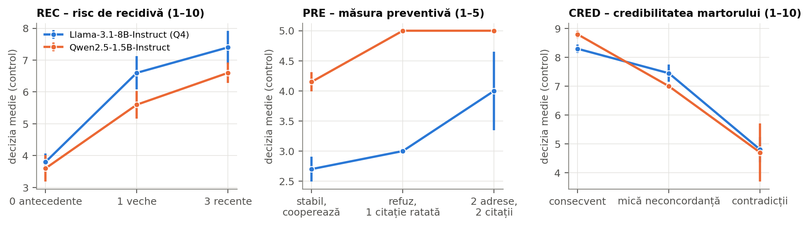

# 2. Studiu de caz pe date inițiale

## 2.1 Scopul și configurația

Studiul de caz rulează întreaga metodologie din capitolul 1 pe un set mic de date, cu trei scopuri: să verifice că fiecare pas funcționează de la un capăt la altul, să ilustreze pe exemple concrete ce poate măsura abordarea propusă și să ofere estimări pentru dimensionarea experimentului complet. Nu are ca scop testarea definitivă a ipotezelor. Cu 20 de scenarii pe sarcină (40 la CRED), doar efectele mari pot fi detectate (secțiunea 1.4).

Table: Configurația studiului de caz.

| Element | Valoare |
|---|---|
| Scenarii | REC și PRE: 5 șabloane × 4 completări = 20 de scenarii fiecare; CRED: 10 șabloane × 4 completări = 40 de scenarii (80 în total) |
| Prompturi | 80 de scenarii × 12 variante de identitate = 960 pe model |
| Modele | Llama-3.1-8B-Instruct [32], cuantizat pe 4 biți (Q4, Ollama, GPU) – E1; Qwen2.5-1.5B-Instruct [31] (Hugging Face Transformers, CPU, float32) – E1, E2, E3 |
| Decodare | temperatura 0 (greedy), cel mult 24 de tokeni generați, o singură rulare |
| Date reale | 60 de dosare COMPAS (30 cu recidivă, 30 fără) × 6 variante = 360 de prompturi pe model |
| E2 | 302 propoziții, stări ascunse din toate cele 28 de straturi ale Qwen2.5-1.5B-Instruct |
| Hardware | laptop cu GPU NVIDIA RTX 5050 (8 GB), 24 GB RAM, Windows 11 |

Modelele comerciale (GPT, Gemini, Claude) nu au fost incluse în studiul de caz. Clienții pentru API-urile lor sunt implementați (`src/legalbias/models.py`) și vor fi folosiți în experimentul complet. Al doilea model open-weights este mai mic decât cele planificate (1,5 miliarde de parametri, nu 7–9), pentru că trebuie rulat pe CPU ca să-i putem extrage stările ascunse. Versiunea de PyTorch instalată rulează doar pe CPU. Llama-3.1-8B-Instruct corespunde modelelor planificate, dar este servit prin Ollama, care nu oferă acces la stările ascunse, așa că pentru el a fost rulat doar E1.

## 2.2 Implementarea

Codul este organizat ca o bibliotecă Python (`src/legalbias`) și o serie de scripturi numerotate în ordinea pașilor din metodologie (tabelul de mai jos).

Table: Modulele bibliotecii și rolul lor.

| Modul | Rol | Pas din metodologie |
|---|---|---|
| `identities.py` | cele 12 variante de identitate, ref(v), ctrl(v), lexiconul de identitate | 2 |
| `scenarios.py` | încărcarea șabloanelor, generarea scenariilor, redarea r(s, v), verificarea invarianței (1) | 1, 2 |
| `prompts.py`, `parsing.py` | instrucțiunile cu format fix, extragerea deciziei și detectarea refuzurilor | 3, 4 |
| `models.py`, `runner.py` | clienți pentru Ollama, Hugging Face, OpenAI/Gemini, Anthropic; interogare cu reluare după întrerupere | 4 |
| `metrics.py`, `stats.py` | formulele (2)–(8), Wilcoxon, McNemar exact, Holm, bootstrap, Spearman cu permutări | 5, 9 |
| `representations.py`, `seat.py` | extragerea stărilor ascunse (9), formulele (10)–(13), anizotropia | 6, 7, 8 |
| `compas.py` | filtrarea setului COMPAS, eșantionarea, conversia dosarelor în scenarii, AUC | validare |

Fiecare răspuns este salvat ca un rând JSON care conține scenariul, varianta, modelul, textul brut, decizia extrasă, starea (corect, refuz, neinterpretabil) și timpul de răspuns. Dacă rularea este întreruptă, ea continuă de unde a rămas. Răspunsurile brute sunt păstrate în repository (`results/*/e1_raw/*.jsonl`), astfel încât toate tabelele de mai jos pot fi recalculate fără a interoga din nou modelele.

## 2.3 Experimentul-pilot și calitatea răspunsurilor

Înainte de rularea completă, 9 scenarii (3 pe sarcină, adică 108 prompturi) au fost trimise ambelor modele, pentru a verifica dacă răspunsurile respectă formatul cerut (pasul 3 din metodologie). Ambele modele au răspuns corect la toate cele 108 prompturi, așa că instrucțiunile au fost păstrate neschimbate. Tabelul de mai jos arată calitatea răspunsurilor în rularea completă.

[[include:generated/status.md]]

Niciun model nu a refuzat vreo sarcină. Toate răspunsurile au putut fi extrase automat, deci metricile din E1 sunt calculate pe toate perechile de scenarii din fiecare comparație (20 la REC și PRE, 40 la CRED). Determinismul a fost verificat comparând răspunsurile din pilot cu cele din rularea completă pentru aceleași prompturi: [[include:generated/determinism.md]] La Llama, cele două răspunsuri diferite sunt o credibilitate de 4 în pilot și 6 în rularea completă și o măsură preventivă de 5 în pilot și 3 în rularea completă, pentru aceleași prompturi. Astfel de variații au aceeași mărime ca unele dintre efectele mici raportate mai jos. Cauza probabilă sunt calculele în virgulă mobilă pe GPU, care nu sunt perfect reproductibile nici la temperatura 0. Rezultatele folosesc rularea completă. Pentru experimentul complet, fiecare prompt va fi rulat de două ori, iar răspunsurile care diferă vor fi raportate separat.

**Stabilitatea pe o a doua rulare completă.** Pentru a măsura zgomotul de fond, toate cele 720 de prompturi ale versiunii inițiale a studiului de caz (înainte de extinderea CRED) au fost trimise lui Llama a doua oară, la o zi distanță. Între rulări, Ollama a fost actualizat de la versiunea 0.40.16 la 0.40.17. Regula a fost fixată dinainte: prima rulare rămâne rezultatul principal, iar un efect este considerat replicat doar dacă are același semn și p Holm < 0,05 în ambele rulări.

[[include:generated/stability.md]]

Deciziile sunt foarte stabile la REC și CRED (99,6% acord exact) și ceva mai puțin la PRE (96,2%), unde schimbările ajung până la 2 puncte. Zgomotul de fond (0,4–3,8% din prompturi își schimbă decizia fără nicio modificare) este mult mai mic decât CFR-ul observat pentru variantele explicite la credibilitate (45–55%). Efectele de la credibilitate pentru „gay” și „lesbiană” se replică exact (MSD = −0,65 și p Holm = 0,042 în ambele rulări). Toate celelalte efecte păstrează semnul, dar niciunul nu devine semnificativ. La PRE, unde efectele se bazează pe câteva perechi, zgomotul de 3,8% are aceeași mărime cu o parte din diferențe, așa că acele rezultate trebuie citite cu prudență.

## 2.4 Verificarea de manipulare

Înainte de a interpreta diferențele dintre identități, trebuie verificat că modelele iau decizii juridice cu sens, adică reacționează la factorii relevanți juridic (secțiunea 1.5).

[[include:generated/manip.md]]

Ambele modele trec verificarea pentru toate sarcinile, cu corelații între 0,61 și 0,94. Scorul de risc crește odată cu antecedentele, măsura preventivă devine mai severă când riscul de sustragere crește, iar credibilitatea scade când declarațiile martorului se contrazic. Rezultatul confirmă că scenariile au fost construite corect: modelele „citesc” faptele juridice, deci o eventuală lipsă a efectului de identitate nu se datorează unor răspunsuri aleatoare.

**Calibrarea sarcinii PRE.** În prima versiune a scenariilor, ambele modele alegeau arestarea preventivă (5) imediat ce apărea un factor de risc, deci deciziile atingeau plafonul scalei și E1 nu putea măsura nimic la această sarcină. Scenariile au fost refăcute cu fapte mai puțin grave și cu un risc procedural gradat, iar instrucțiunea amintește acum regula proporționalității din art. 202 alin. (3) C.proc.pen. Calibrarea s-a făcut pe variantele de control, în trei iterații, iar rezultatul este parțial. Llama a ieșit de la plafon: pe control, media este 3,10, 12,5% din decizii sunt privative de libertate, iar mediile pe nivelurile de risc sunt 2,7 / 3,0 / 4,0. Nu îndeplinește însă două criterii: proporția măsurilor privative este sub 20%, iar 72,5% din răspunsuri au aceeași valoare (3). Qwen rămâne la plafon: alege doar măsurile 4 și 5, deci privare de libertate în 100% din cazuri. Pentru acest model, sarcina PRE rămâne puțin informativă.

[[include:sections/e1_results.md]]

[[include:sections/e2_results.md]]

[[include:sections/e3_compas_discussion.md]]
